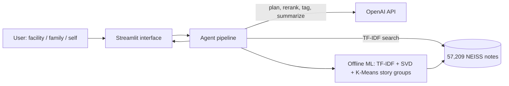
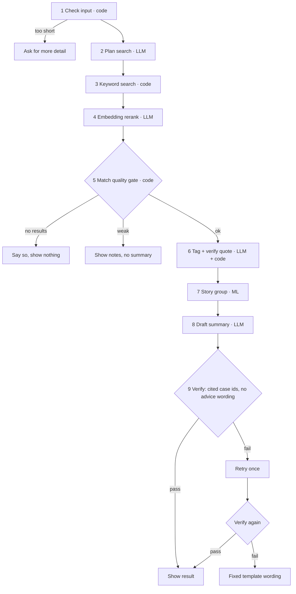

# Fall Case Review Assistant
DESIGNTK 530 Final Project, Checkpoint 2 · Alfonzo Yates · Duke M.Eng. Design and Technology Innovation

A web app (Streamlit) where a person describes a fall in their own words and gets the most similar real emergency-department notes, a short cited summary, and a checklist of questions. It does **not** diagnose, predict who will fall, or give medical advice.

**Live app:** _paste your Streamlit Cloud link here_


> AI disclosure: Claude (Anthropic) helped write the code in this repo. Files carry a comment saying so. I reviewed the logic and the tests. See "What was and was not tested" at the bottom.

## Part 1. Scope, users, architecture

**Users (one app, three modes).** Facility staff (falls coordinator reviewing a fall), a family member or caregiver, and an older adult looking at their own situation. The mode changes the wording of the summary, the safety notice, and whether admission statistics are shown (hidden for the older adult).

**Input → output → decision → action → outcome**

| Input | Output | Decision | Action | Outcome |
|---|---|---|---|---|
| A short description of a fall (plus optional place and age filters) | 5 similar real notes, factor tags with quotes, story group, cited summary, questions to check | Is this like cases where a factor mattered? Is a clinical check needed? | Ask the listed questions, follow facility protocol, or contact a doctor | A better-informed fall review; never a diagnosis |

**Dataset continuity.** The same 57,209 NEISS 2024 fall notes (adults 65+) from earlier checkpoints. Instead of a precomputed vector index, the app does hybrid retrieval over all notes at run time (TF-IDF keyword search, then an embedding rerank of the top 60). Factor tags are generated on the fly for the retrieved cases only. Raw-note keyword themes from the earlier notebook are reused as the comparison baseline for the clustering.



## Part 2. LLM and agentic workflow


The agent is a fixed, logged sequence (not free-roaming). Every step appears in the "How this answer was produced" panel with its type (code / AI / ML), result and time.

**Guardrails.** Red-flag phrases (head strike, blood thinners, can't get up, etc.) show a safety notice first. Descriptions and notes are passed to the model as data with an instruction to ignore embedded instructions. Every summary item must cite retrieved case ids; items citing unknown cases or using advice-like wording (diagnose, dose, "at risk", prognosis) are removed. Every AI tag needs a quote that appears word for word in the note, otherwise it is shown as "unverified". Input is capped at 1,200 characters.

**Failure modes and what happens**

| Failure | Behavior |
|---|---|
| No key / key rejected / quota / network | Code-only mode: keyword search, rule-based tags, fixed-wording summary, with a visible notice |
| Model returns bad JSON | Step falls back (rule tags or template summary) |
| Invented citation or advice wording | Removed; one retry; then template wording |
| Weak match | Closest notes shown, **no summary**, plain explanation |
| No match / too-short input | Says so instead of guessing |
| Unexpected exception | Friendly error, no stack trace |

Match-quality thresholds (embedding 0.30, keyword 0.12) are first guesses and **not calibrated**.

## Part 3. Non-LLM machine learning

Pipeline (`build_ml.py`, run offline; seed 42): clean text (abbreviations expanded, ages removed, only the text before "DX" so injury words don't dominate) → TF-IDF (1-2 grams, min_df 5, max_df 0.5, 20k features, sublinear tf) → TruncatedSVD (50 components) + normalize → K-Means (k = 8) → 2-D PCA for the map.

| Evidence | Value |
|---|---|
| Silhouette, k = 8 | 0.079 (low: groups overlap; kept k = 8 for interpretable size) |
| Seed stability (ARI, 3 reseeds) | 0.38 to 0.73, mean 0.515 (moderate) |
| Agreement with keyword themes (NMI) | 0.202 (weak-moderate) |
| Admission AUC, group alone vs age alone | 0.605 vs 0.542 (weak signal) |
| Variance kept by SVD | 17.6% |

**Role in the app.** Each retrieval gets a story-group label and, outside the older-adult mode, the group's historical admission rate. A "mixed results" warning appears when fewer than 40% of matched cases share a group. A map shows where the matches sit.

**Limitations.** Groups are loose and only moderately stable; they describe note wording, not a person's risk. NEISS covers people who reached an emergency department, so minor falls are missing. Admission context is historical and never framed as a prediction.

## Part 4. Interface and UX decisions

Navigation: three tabs (Check a fall · How it works · About the data and models). Feedback: live step-by-step status while running, a trace table, a "this tag looks wrong" button per case. Empty state (3-step explainer), error, weak-match, no-results, short-input, offline and reduced-mode states are all designed. Responsive layout checked at 390 px and 1100 px (`docs/`).

Two consequential decisions and their revisions (honest note: these revisions came from my own walkthrough of the app and agent tests; real tester feedback should be added below):

1. **Show the original note word for word beside every tag.** First draft showed only the AI's tag and the summary. Walking through it, nothing let a user check the AI. Revision: each case card shows the verbatim note, the tag, a "quote checked / rule / unverified" label, and summary items carry case chips.
2. **Refuse to summarize weak matches.** First draft always wrote a summary. A nonsense description still produced confident text. Revision: a match-quality gate, a "weak match" state with no summary, and an explicit no-results state.

Other revisions: safety notice moved above all results and made mode-aware; admission rates hidden for the older-adult mode; plain-language labels instead of category codes.

### User test results
_Add 3-5 testers here: who, task, what confused them, what I changed._

## Files

| File | What is in it |
|---|---|
| `app.py` | The Streamlit interface: page styling (HTML/CSS in the portfolio colors), the three tabs, the form, results, and error/empty states |
| `agent.py` | Everything behind the interface: text cleaning, the OpenAI wrapper, keyword search, and the 9-step agent with its guardrails and fallbacks |
| `build_ml.py` | Offline ML script (TF-IDF, SVD, K-Means). Run once; it writes the two data files below |
| `data/falls.csv.gz` | The 57,209 notes, each with its story group and map position |
| `data/ml_info.json` | ML metrics, group profiles, and the group names |
| `requirements.txt` | Python packages for Streamlit Cloud |
| `tests/test_agent.py` | Agent tests with a fake AI client (no key needed) |

## Run it

```
pip install -r requirements.txt
streamlit run app.py
python3 tests/test_agent.py       # agent tests (no key needed)
python3 build_ml.py               # optional: rebuild the ML outputs (needs ../neiss2024_older_adult_falls.csv)
```
The API key is read from Streamlit secrets (`OPENAI_API_KEY`, optional `OPENAI_MODEL`) or an environment variable. For local runs create `.streamlit/secrets.toml` containing `OPENAI_API_KEY = "..."`; it is listed in `.gitignore`, so never commit it.

Deploy: push to GitHub, then share.streamlit.io, New app, `app.py`, and paste the key in Secrets. The first load builds the search index (a few seconds).

## What was and was not tested
Tested: retrieval, tagging checks, verifier, fallbacks, ML data, and the page logic with a fake AI client (13 scenarios pass); HTML/CSS rendered at phone and desktop widths; app.py runs top to bottom against a stand-in for Streamlit in all three modes.
**Not tested yet:** live OpenAI calls (model name `gpt-6-astra` and the Responses API as in the class notebook), real Streamlit rendering (button styling selectors), and real users.

Data: U.S. CPSC NEISS 2024, adults 65+ falls. Not medical advice.
