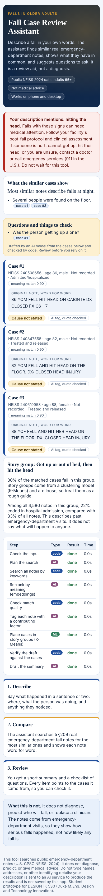
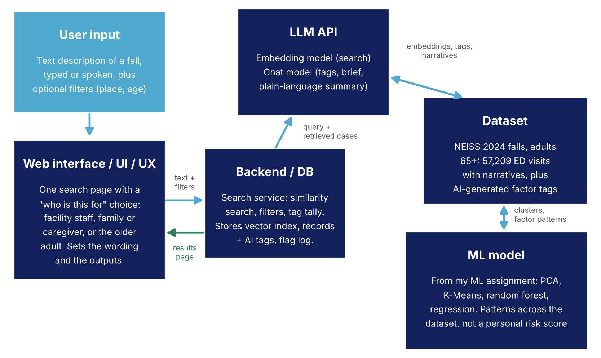
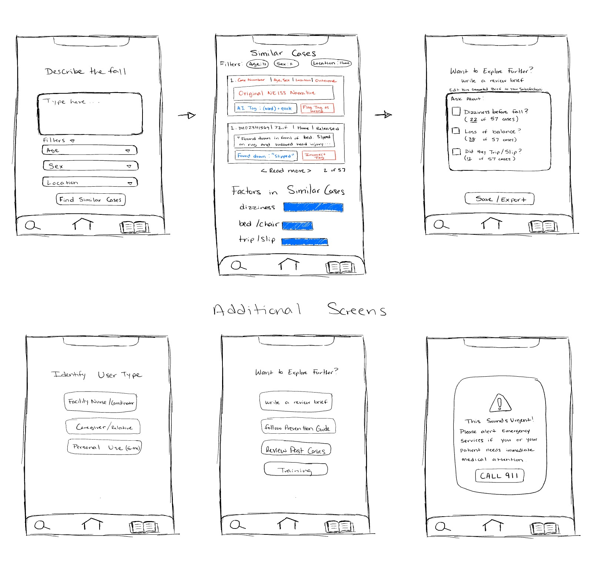
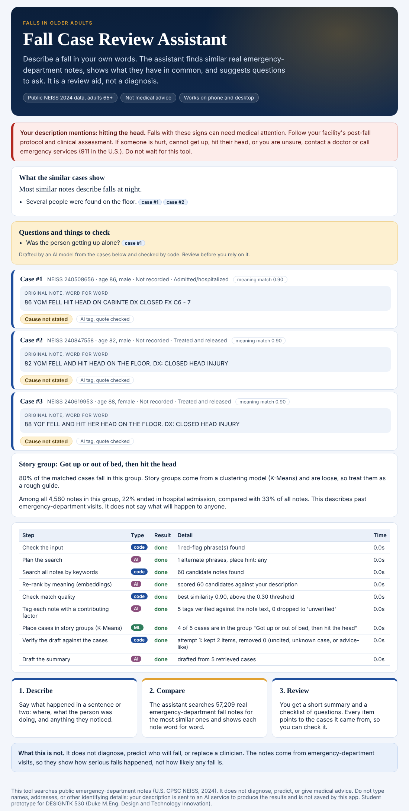
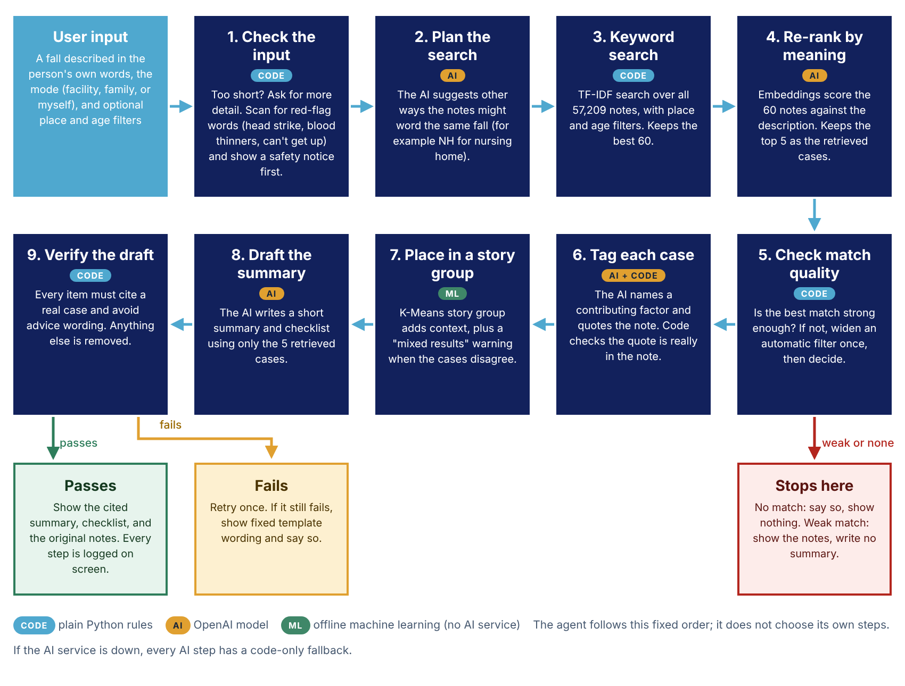

# Fall Case Review Assistant

Alfonzo Yates - DESIGNTK 530 Final Project, Checkpoint 2 

**Live app:** https://fallsapp-hpi9iyqtpdcxdmubtxxxrb.streamlit.app/ 

A web app where a person describes a fall in their own words and gets the most similar real emergency-department notes, a short cited summary, and a checklist of questions to ask. It does **not** diagnose, predict who will fall, or give medical advice.

For this checkpoint I mainly wanted to focus on functionality. Next, I will enlarge the app's capabilities across multiple screens and added functionalities.

> AI disclosure: Claude helped write the code in this repo, and the code files say so. I reviewed the logic and ran tests.

---

## 1 Define your scope, users and objective(s)

### Use case and objective
**Problem.** After a fall, the people involved need to work out what to look into and what to change. Incident notes and emergency-department records are short free text, and the structured fields (where, when, injury) say little about how the fall started. Finding similar past cases means reading notes by hand or searching exact keywords, which miss different wording such as "found down," "long lie," or "NH."

**Objective.** A focused search-and-review aid built on 57,209 emergency-department fall narratives: one engine, three ways to use it. It helps a person see what similar real falls looked like, with the evidence one click away, so they can decide what to look into or ask about. It is a review aid, not a risk score or medical advice.

### Users
| User | Situation | What success looks like |
|---|---|---|
| Care-facility coordinator (fall-prevention or quality-improvement nurse or administrator) | The post-fall huddle or monthly falls review, with a fresh incident note and about fifteen minutes to prepare | Leaves with a short list of factors to investigate, each tied to cited source notes |
| Family caregiver (child, relative, or other caregiver of an older adult) | The day after a parent or relative falls or nearly falls, wondering what happened and what to ask a doctor | Sees what similar falls looked like, has a short list of questions, and knows when to contact a clinician |
| Older adult using it themselves | After their own fall or near-fall, wanting plain-language answers | Reads stories like theirs in plain words, picks one or two things to ask about, and knows when to call a doctor |

In the app a "Who is using this?" choice sets the wording of the summary and the safety notice. Hospital-admission statistics are hidden for the older-adult mode.

### Architecture
Last week's architecture, following the course template:

*What changed in the build:* the search does not use a precomputed vector index. It runs a keyword search over all 57,209 notes, then re-ranks the top 60 with embeddings at run time. The ML box is now TF-IDF + SVD + K-Means (the random forest and regression were dropped, see section 4). Records are not stored in a database, and the flag log lasts for the session only.

### Inputs, outputs, decision, action, and outcome
**Input and modality:** text. The user types a description of the fall (optional place and age filters are dropdowns). **Output:** five similar real cases with the original note, a cited summary, and questions to check. **Successful interaction:** the person leaves knowing what similar falls looked like and what to look into or ask about, and can trace every statement back to a real note.

| | Facility staff | Family caregiver or older adult |
|---|---|---|
| **Input** | Typed description of the fall, optional place and age filters | Description in everyday words, same optional filters |
| **Output** | 5 similar cases with the original note word for word, similarity score, AI tag with a checked quote, story group, cited summary and questions to check | Same cases, plain-language summary and questions, a "when to get medical help" notice |
| **Decision supported** | Which contributing factors to look into first | What to ask or look at first, and whether to contact a clinician now |
| **System action** | Searches, ranks, tags, and drafts a summary using only the retrieved cases, with citations | Same, with a safety notice at the top when the text mentions a head strike, blood thinners, or being unable to get up |
| **Outcome** | A sourced list of questions for the review | Knows what to look at and what to bring to a doctor or family |

### Interface sketch
Last week's sketch:

Built in this checkpoint: the three-way mode choice, the description box and filters, similar cases with the original note and a tag, a flag button, the safety notice, and a low-match warning. Not built yet: voice input, the factor bar chart, the PDF export (a text download is provided instead), the room checklist, and the share button.

### Dataset continuity: deviations and iterations
- **Same data.** The 2024 NEISS public file of emergency-department visits for falls by adults 65 and older (57,209 visits), with the narrative as the searchable text.
- **Changed.** Instead of embedding a 2,000-note sample, the app searches all notes by keyword and embeds only the top candidates for each question. The eight-category factor tags from the earlier 50-row test are now generated on the fly for the 5 retrieved cases, and each tag must come with a quote that appears in the note.
- **Carried over.** The keyword themes from the earlier notebook are the baseline the clustering is compared against in section 4.
- **Limits.** NEISS covers only falls that reached an emergency department, has no denominators, and its notes are short and written by hospital staff. Counts describe retrieved cases and are not rates. The home mode uses the same search with different wording; narratives rarely name hazards (about 10% name a detail such as a rug or railing), so a home checklist would need outside home-safety guidance.

---

## 2 Establish the User Experience and Service Design

**Understandable without me present.** The first screen shows a three-step explainer (describe, compare, review), a plain statement of what the tool is not, and a privacy note. The "How it works" tab explains the steps in plain words. **Navigation and structure.** Three tabs: *Check a fall* (the tool), *How it works* (the agent steps), and *About the data and models* (the ML evidence).

**Feedback while it works.** A live step-by-step status appears while the assistant runs, followed by a "How this answer was produced" table showing each step, whether it used code, AI, or ML, and how long it took. Each case has a "this tag looks wrong" button.

**States designed.** First visit (a 3-step explainer), loading, success, weak match, no match, description too short, AI unavailable (reduced mode), no key (offline mode), and unexpected error. The layout was checked at phone width and desktop width, and the colors follow my portfolio site.

### Consequential decisions and how I revised them
1. **Show the original note, word for word, beside every tag.**
   *First version:* showed only the AI's tag and the summary. *Problem found when I walked through it:* nothing let a user check the AI. *Revision:* each case card shows the verbatim note, the tag, a label saying whether the quote was checked, and the summary items carry case-number chips that point to the cards.
2. **Refuse to summarize when the match is weak.**
   *First version:* always wrote a summary. *Problem found when I tried a nonsense description:* it still produced confident text. *Revision:* a match-quality check, a "weak match" state that shows notes but no summary, and a separate no-results state.

**Smaller revisions.** The safety notice moved above all results and changes with the mode. Admission rates are hidden in the older-adult mode. Plain-language labels replaced category codes.

---

## 3 Integrate an LLM and an agentic workflow

The assistant follows a fixed, nine-step order. It does not choose its own steps, which keeps it predictable and checkable. Each step is shown on screen under "How this answer was produced."

**What the AI does:** suggests other ways the notes might word the same fall, re-ranks candidates by meaning, tags each case with a contributing factor, and drafts the summary. **What plain code does:** checks the input, searches, checks match quality, verifies quotes, and verifies the draft. The AI never gets the last word.

### Stages, tools, data, and decisions
| Stage | Tool | Data accessed | Output | Decision point |
|---|---|---|---|---|
| 1 Check input | Python rules | The typed description | Safety flags | Too short? Ask for more |
| 2 Plan search | OpenAI chat model | The description | Alternate phrases, place hint | None (failure falls back to the user's own words) |
| 3 Keyword search | TF-IDF in Python | All 57,209 notes | 60 candidates | None |
| 4 Re-rank | OpenAI embeddings | The 60 candidate notes | Top 5 cases | None (failure keeps keyword order) |
| 5 Check quality | Python thresholds | Similarity scores | Strong, weak, or none | Stop, widen a filter, or continue |
| 6 Tag | OpenAI chat model + Python check | The 5 notes | Factor tag with a verified quote | Quote not in the note? Mark "unverified" |
| 7 Story group | K-Means (offline ML) | Precomputed groups | Group label, mixed-results warning | Warn if cases disagree |
| 8 Draft | OpenAI chat model | The 5 notes and tags only | Summary and checklist | None |
| 9 Verify | Python rules | The draft and the 5 case ids | Verified summary | Pass, retry once, or fixed wording |

The LLM is used for synthesis, classification (the factor tags), and structured output (JSON the code can check).

### Guardrails
- Red-flag words (head strike, blood thinners, can't get up, and similar) show a safety notice before anything else.
- The description and the notes are sent to the model as data, with an instruction to ignore any instructions inside them.
- Every item in the summary must cite one of the 5 retrieved cases. Items that cite a case that does not exist, or that use advice-like wording (diagnose, dose, "at risk," prognosis), are removed.
- Every AI tag must come with a quote that appears word for word in the note. Otherwise the tag is shown as "unverified."
- Input is capped at 1,200 characters, and the privacy note tells people not to type names or addresses.

### Failure modes and what happens
| Failure | What the app does |
|---|---|
| No key, key rejected, no credits, or network down | Runs on code only (keyword search, rule-based tags, fixed-wording summary) and says so on screen |
| The model returns unreadable output | That step falls back to rule-based tags or the fixed-wording summary |
| The draft invents a citation or uses advice wording | The item is removed, the draft is retried once, then fixed wording is used |
| Weak match | Shows the closest notes, writes **no summary**, and explains why |
| No match, or description too short | Says so instead of guessing |
| Unexpected error | Shows a plain error message, never a stack trace |

### When the system cannot answer reliably
The match-quality check (step 5) is the safeguard. If even the best note is a poor match, the app shows the notes and stops there rather than writing a confident-sounding summary. The cutoffs (0.30 for embedding similarity, 0.12 for keyword similarity) are first guesses and have **not** been calibrated against real use.

---

## 4 Incorporate traditional machine learning

### The question, in plain terms
*"What kinds of fall stories show up in these notes, and which kind is this case most like?"* The notes do not come with a label for story type, so the computer has to find the groups on its own. This is called clustering. It fits because the app needs readable background for a case ("this looks like the bed-exit group"), not a prediction. I did not train a model to predict admission or fall risk: the data only includes people who reached an emergency department, so a risk score would be misleading.

### What the computer does, step by step
1. **Clean the notes.** Abbreviations are spelled out (NH becomes nursing home), ages are removed, and only the text before "DX" is kept. That part describes how the fall happened, while the text after it describes the injury.
2. **Turn words into numbers (TF-IDF).** Each note becomes a list of scores for the words and two-word phrases it uses. Words that appear in many notes count for less, and distinctive words count for more.
3. **Choose which words to keep (feature selection).** Common filler words are dropped, and so are words that appear in fewer than 5 notes or in more than half of all notes. The top 20,000 remaining terms are kept.
4. **Shrink the list (SVD).** The long word lists are compressed into 50 numbers per note that capture the main patterns of wording.
5. **Group similar notes (K-Means).** The computer sorts the notes into 8 groups so that notes in the same group use similar wording. A fixed random seed (42) makes the result repeatable.
6. **Draw the map (PCA).** The 50 numbers are squeezed into 2 so the groups can be shown as a map.

### How to read the results
Each group got a plain-language name that I wrote after reading its most common words and a sample of its notes (for example, "Fell onto the hip"). The names are mine, not the model's. A group's admission rate means "how many past notes in this group ended in hospital admission." It describes history and never predicts what will happen to anyone. On the map, notes that sit close together are worded alike.

### Where it shows up in the app
- Every result shows the **story group** the matched cases mostly belong to.
- For facility and family use, it shows how often that group's past visits ended in admission, compared with all notes.
- A **"mixed results" warning** appears when fewer than 40% of the matched cases share a group.
- A **story map** shows where the matched cases sit among the other notes.

### How well it works (limitations, with evidence)
| Measure | Result | What it means |
|---|---|---|
| Silhouette score (k = 8) | 0.079 | Scale runs from -1 to 1, and near 0 means the groups overlap a lot. These are loose groups, not clean boxes. |
| Stability when re-run with different random starts (ARI) | 0.38 to 0.73, average 0.515 | 1.0 means identical groups every time. Here the groups are similar from run to run but not the same. |
| Match with the simple keyword themes (NMI) | 0.202 | The groups only partly agree with themes found by keyword rules, so they add some, but not much, beyond them. |
| Admission predicted from group alone vs age alone (AUC) | 0.605 vs 0.542 | 0.5 is a coin flip. Group is slightly more informative than age, but both are weak. |
| Share of the original information kept after shrinking | 17.6% | Most of the detail in the wording is lost, which is one reason the groups are loose. |

Because of this, the groups are used as **rough background**, never as a score for a person. The data also only covers falls that reached an emergency department, so minor falls are missing.

*Technical settings (for reference):* TF-IDF with 1 to 2 word phrases, min_df 5, max_df 0.5, 20,000 features, sublinear term frequency; TruncatedSVD with 50 components and normalization; K-Means with k = 8 chosen for readable group sizes (silhouette keeps rising with larger k, so it did not pick a clear winner); PCA to 2 dimensions for the map. Code is in `build_ml.py`.

---

## Files
| File | What is in it |
|---|---|
| `app.py` | The Streamlit interface: styling (HTML and CSS in the portfolio colors), the three tabs, the form, the results, and the error and empty states |
| `agent.py` | Everything behind the interface: text cleaning, the OpenAI wrapper, keyword search, and the nine-step agent with its guardrails and fallbacks |
| `build_ml.py` | The offline ML script (TF-IDF, SVD, K-Means). Run once; it writes the two data files below |
| `data/falls.csv.gz` | The 57,209 notes, each with its story group and map position |
| `data/ml_info.json` | ML metrics, group profiles, and group names |
| `requirements.txt` | Python packages for Streamlit Cloud |
| `tests/test_agent.py` | Agent tests using a fake AI client (no key needed) |
| `docs/` | Figures used in this README |

## What was and was not tested
**Tested:** retrieval, tag checks, the verifier, and all fallbacks, using a fake AI client (13 scenarios pass); the ML outputs; the page logic running top to bottom against a stand-in for Streamlit in all three modes; and the page's HTML and CSS at phone and desktop widths.

**Not tested:** live OpenAI calls (model `gpt-6-astra` and the Responses API), real Streamlit rendering of the button styling, and real users.

Data: U.S. CPSC NEISS 2024, adults 65+ falls. Not medical advice.
